# MultiCulture Riddles: analysis report

This report analyses the canonical v0--v2 corpus (6,100 valid, unique
riddles) and the 12 model submissions with complete archive coverage as of 9
August 2026. Every PNG embedded below has
a corresponding PDF in the same directory for use in a paper draft.

## Scope and data quality

Each of the 61 communities contributes 100 riddles. Model evaluation excludes
the documented erroneous `spanish_cuba_history_016` prompt, leaving 6,099
responses per complete model. Missing English fields are counted only where an
English translation is required: English-Canada and English-US are native
English communities and are therefore not expected to supply duplicate English
translation fields.

**Table S1. Corpus audit.**

| Metric                            | Value |
| --------------------------------- | ----: |
| Riddles                           | 6,100 |
| Communities                       |    61 |
| ISO language labels               |    51 |
| Missing required English riddles  |     8 |
| Missing required English answers  |    42 |
| Riddles with a human answer score | 1,765 |

Nine early v1 Drive runs contained 100 Vietnamese v2 riddles. The loader uses
the canonical corpus round and removes these out-of-round duplicates, so each
Vietnamese response is counted once.

## Riddle analysis

### Translation coverage

The remaining translation gaps are limited: Marathi accounts for 37 missing
English reference answers, and the other gaps are sparse. The native-English
communities are not a data-quality issue merely because their duplicate English
fields are empty.

**Table R1. Corpus coverage by region.** Regions are explicit, reviewable
groupings in `corpus_metadata.csv`. “Missing English” excludes native-English
communities; the table intentionally reports riddles rather than communities.

| Region                | Riddles | Languages | Missing English riddles | Missing English answers | Human-score coverage |
| --------------------- | ------: | --------: | ----------------------: | ----------------------: | -------------------: |
| Sub-Saharan Africa    |     500 |         5 |                       0 |                       0 |                 0.4% |
| North Africa          |     400 |         4 |                       0 |                       0 |                94.8% |
| North America         |     300 |         2 |                       0 |                       0 |                53.7% |
| Caribbean             |     100 |         1 |                       0 |                       0 |                 0.0% |
| South America         |     300 |         2 |                       1 |                       0 |                33.3% |
| Europe                |   1,400 |        14 |                       2 |                       2 |                35.7% |
| West Asia             |     400 |         3 |                       0 |                       0 |                43.2% |
| Central Asia          |     100 |         1 |                       0 |                       0 |               100.0% |
| South Asia            |   1,400 |        13 |                       3 |                      40 |                21.2% |
| East & Southeast Asia |   1,200 |         9 |                       2 |                       0 |                 4.4% |

### Validation metadata

Recorded human answer scores cover 37.8% of v0, 25.0% of v1, and none of v2.
The v2 zero indicates absent fields, not failed validation. Cross-round human
quality claims should therefore await more complete metadata.

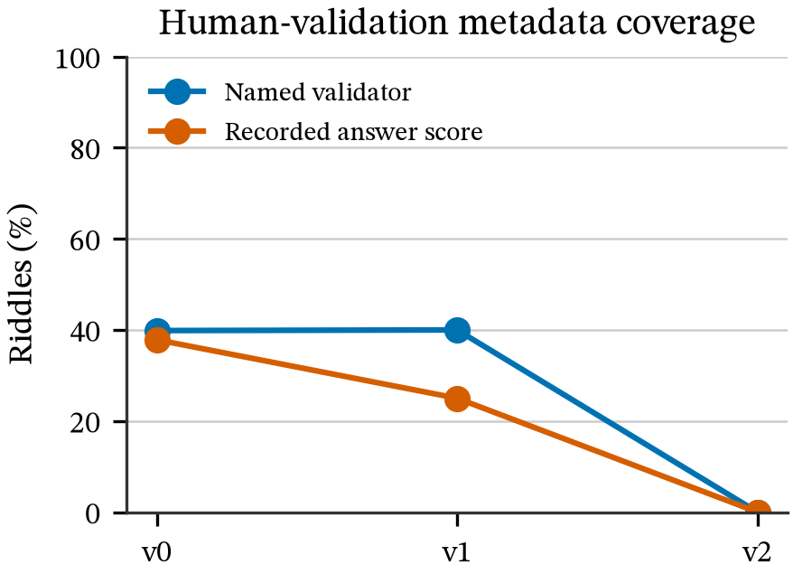

_Figure R1. Availability of validation metadata by collection round._

### Wildcard topics

An exclusive manual coding assigns each of the 122 wildcard selections to one
primary theme. Theme names have been shortened for legibility. Food is the
largest theme: 33 selections (27%) across 33 communities (54%).

**Table R2. Exclusive manual wildcard-theme coding.**

| Theme            | Selections |
| ---------------- | ---------: |
| Food             |         33 |
| Nature           |         19 |
| Language         |         17 |
| Media            |         16 |
| Religion         |          8 |
| Society          |          8 |
| Health           |          6 |
| Science          |          4 |
| Material Culture |          4 |
| Economy          |          3 |
| Places           |          2 |
| Heritage         |          2 |

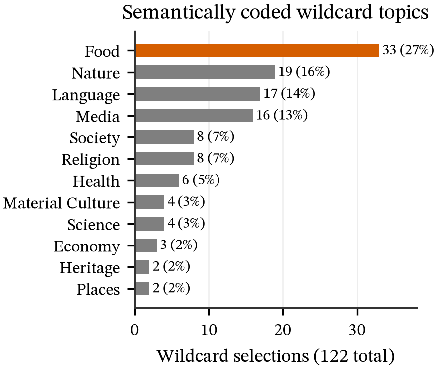

_Figure R2. Exclusive coding of 122 community wildcard selections._

### English text length

English riddle length differs modestly by topic and region. These are
translation lengths, not measures of intrinsic source-language complexity;
missing English text is excluded.

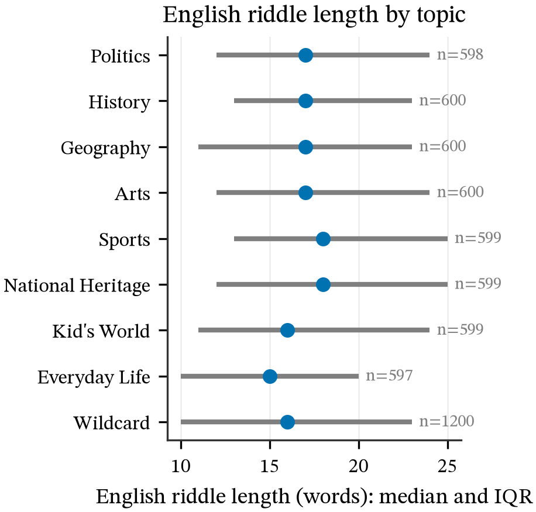

_Figure R3. Median and IQR of English riddle length by topic._

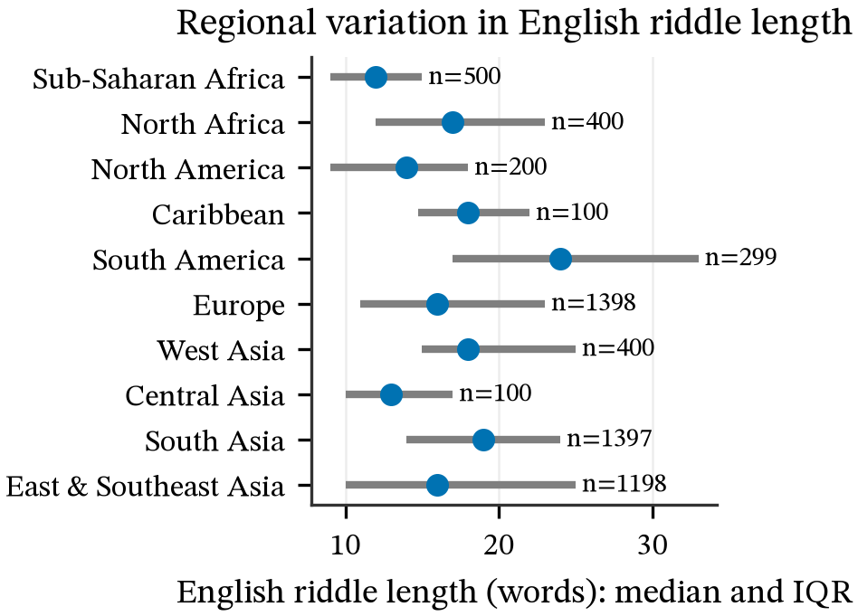

_Figure R4. Median and IQR of English riddle length by region._

## Riddle-writing analysis

The anonymized reflection form contains 76 responses. Results describe the
participating contributors, not all riddle writers or national-linguistic
communities.

Contributors report high confidence: 42 selected 5/5 and 33 selected 4/5.
Personal knowledge or experience was selected by 74 respondents, followed by
online encyclopedia/general search (52) and consultation with a native speaker
or community member (42).

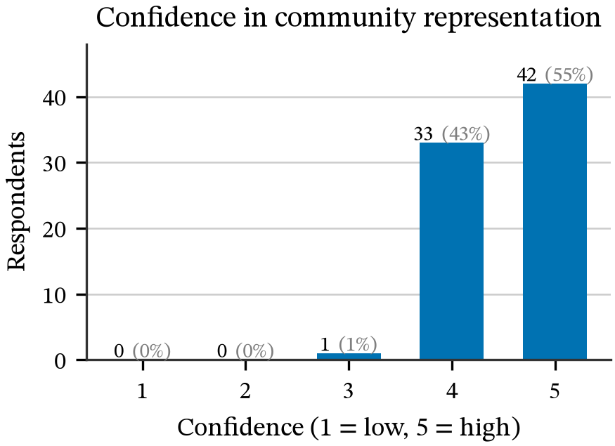

_Figure W1. Self-reported confidence in community representation._

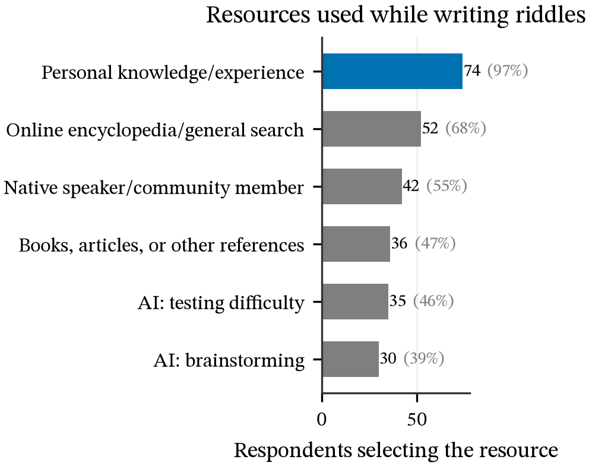

_Figure W2. Resources selected while writing; selections are not mutually exclusive._

### Topic difficulty and model performance

Politics has the highest reported writing difficulty (3.41/5; n=59), whereas
Everyday Life is lowest (2.37; n=63). The correlation plot compares these ratings
with the mean strict AI match rate across the 12 evaluated models, excluding Wild
Card because its broad composition produces too much variation. Across the eight
fixed topics, the Spearman correlation is +0.31: the relationship is modest
and in the opposite direction from the proposed inverse relationship. It is
descriptive only, given eight aggregate observations and the confounding effects
of topic content, language, and answer conventions.

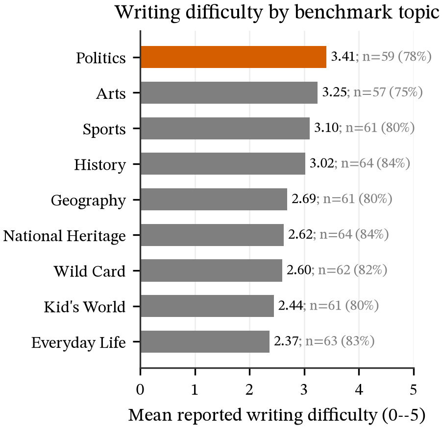

_Figure W3. Reported topic-writing difficulty by benchmark topic._

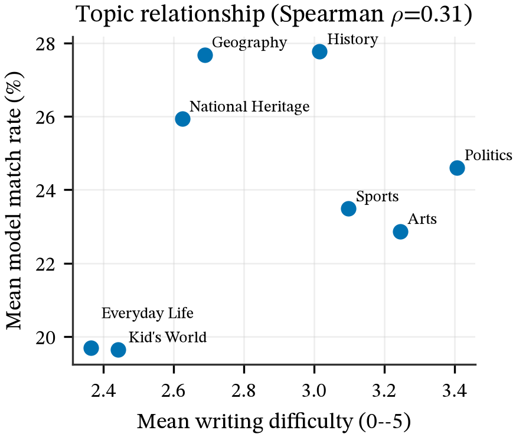

_Figure W4. Association between reported topic-writing difficulty and mean model match rate across the eight fixed topics; Wild Card is excluded._

Most respondents estimated fewer than 15 minutes per complete riddle; sixteen
said time varied too much to estimate. National and mixed specificity strategies
were tied as most common (26 respondents each), while only two respondents
reported mainly niche knowledge. For generative AI, 35 respondents selected
testing difficulty, 30 brainstorming, and four paraphrasing or co-writing.

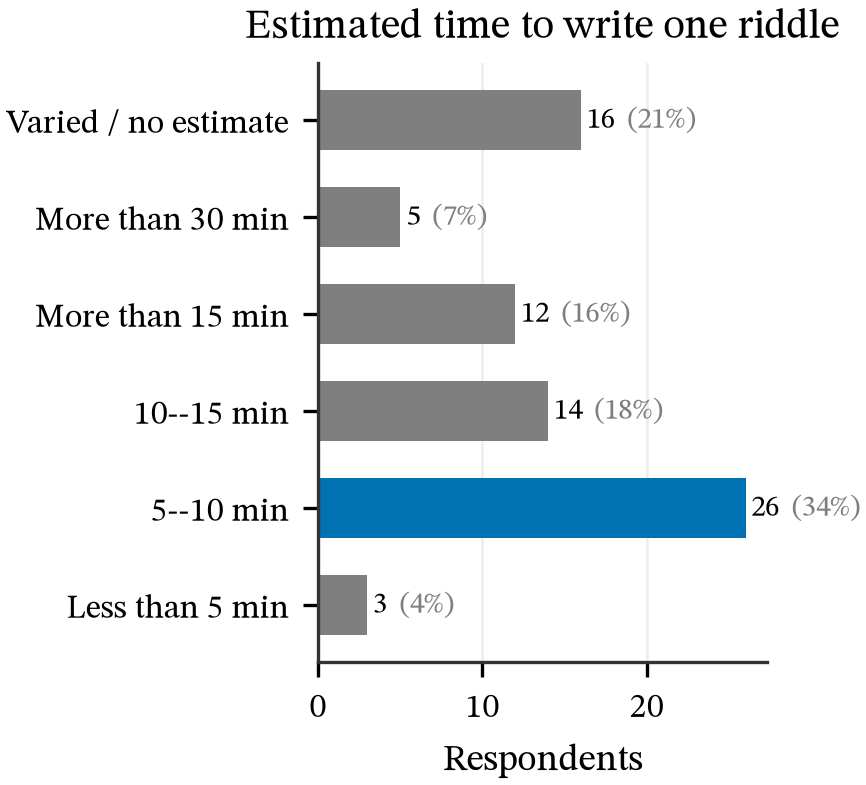

_Figure W5. Estimated time to write one complete riddle._

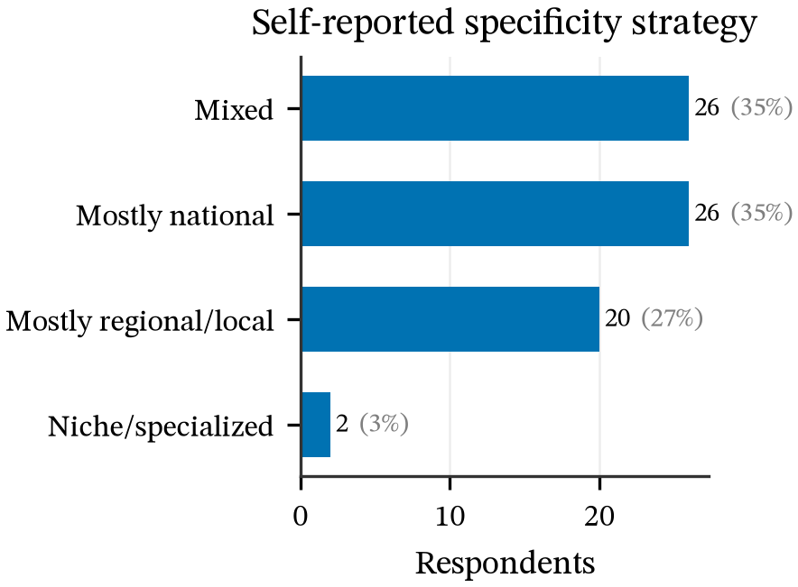

_Figure W6. Contributors’ reported specificity strategy._

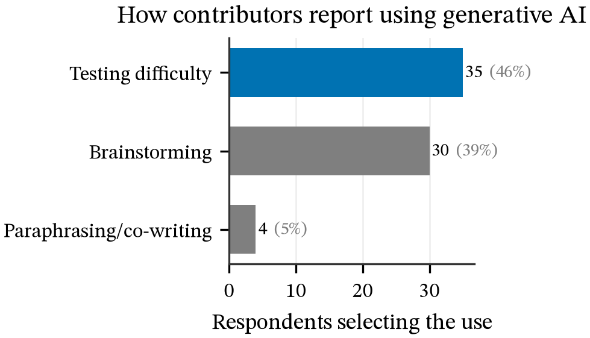

_Figure W7. Reported functions of generative AI in riddle writing._

## Model performance analysis

### Metric

All performance figures use the strict match rate: the number of responses
receiving score 3 divided by **all** responses. Scores 0--3 are not treated as
a linear scale. Score 1 denotes explicit uncertainty, and score 2 is not used
by the current deterministic evaluator; Figure M2 retains their distribution
only as a diagnostic.

**Table M1. Full-corpus strict match rate.** GPT5.5 Search used web search and
is labelled accordingly.

| Model                     | Match rate | Coverage | Evaluation     |
| ------------------------- | ---------: | -------: | -------------- |
| gemini-3.1-pro-preview    |      64.7% |   100.0% | closed book    |
| GPT5.5-search             |      51.5% |   100.0% | search enabled |
| deepseek-v4-pro-thinking  |      50.4% |    98.9% | closed book    |
| deepseek-v4-pro           |      46.6% |   100.0% | closed book    |
| Apertus-v1.5-70B          |      14.7% |   100.0% | closed book    |
| EuroLLM-22B-Instruct-2512 |      11.6% |   100.0% | closed book    |
| Apertus-70B-Instruct-2509 |      11.3% |   100.0% | closed book    |
| Apertus-v1.5-8B           |       7.7% |   100.0% | closed book    |
| Apertus-8B-Instruct-2509  |       5.4% |   100.0% | closed book    |
| Tiny-Aya earth            |       4.7% |   100.0% | closed book    |
| Tiny-Aya fire             |       4.7% |   100.0% | closed book    |
| Tiny-Aya water            |       4.6% |   100.0% | closed book    |

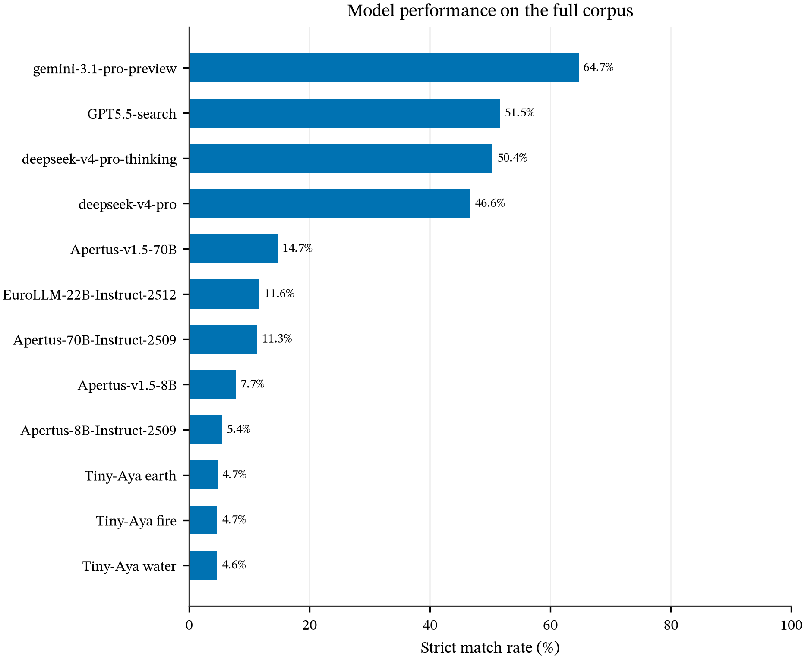

_Figure M1. Strict score-3 match rate over all responses; labels give exact rates._

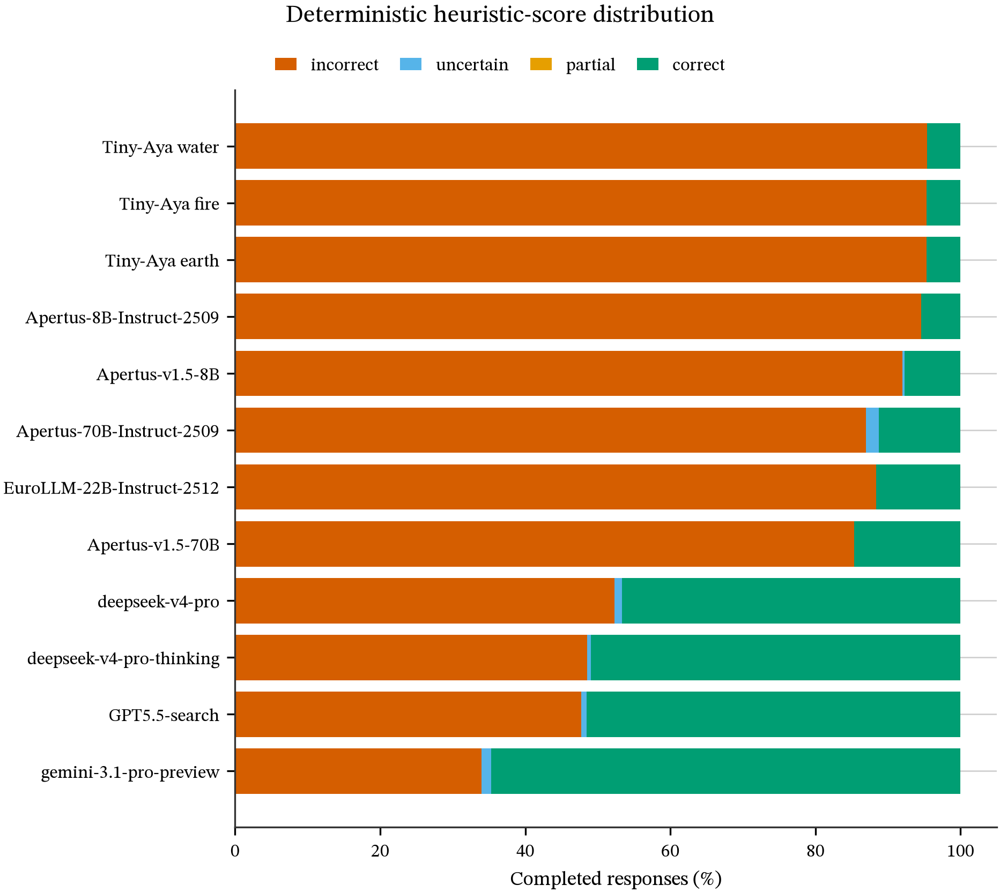

_Figure M2. Deterministic outcome distribution; it is diagnostic and is not averaged as a score._

### Shared difficulty patterns

Topics in Figure M3 are ordered from highest to lowest mean model match rate.
History (27.8%) and Geography (27.7%) are highest, while Kid’s World (19.6%)
and Everyday Life (19.7%) are lowest. Model-specific topic rankings closely
follow this aggregate ordering (median Spearman rho = 0.94 across models), so
the aggregate is more informative than twelve near-parallel rows. Gemini is the
main exception (rho = 0.52); all other models are at least 0.83. The ranked,
model-averaged topic profile is therefore the appropriate main-text comparison
with perceived writing difficulty (Figure W4), while the full matrix is most
useful as a robustness check.

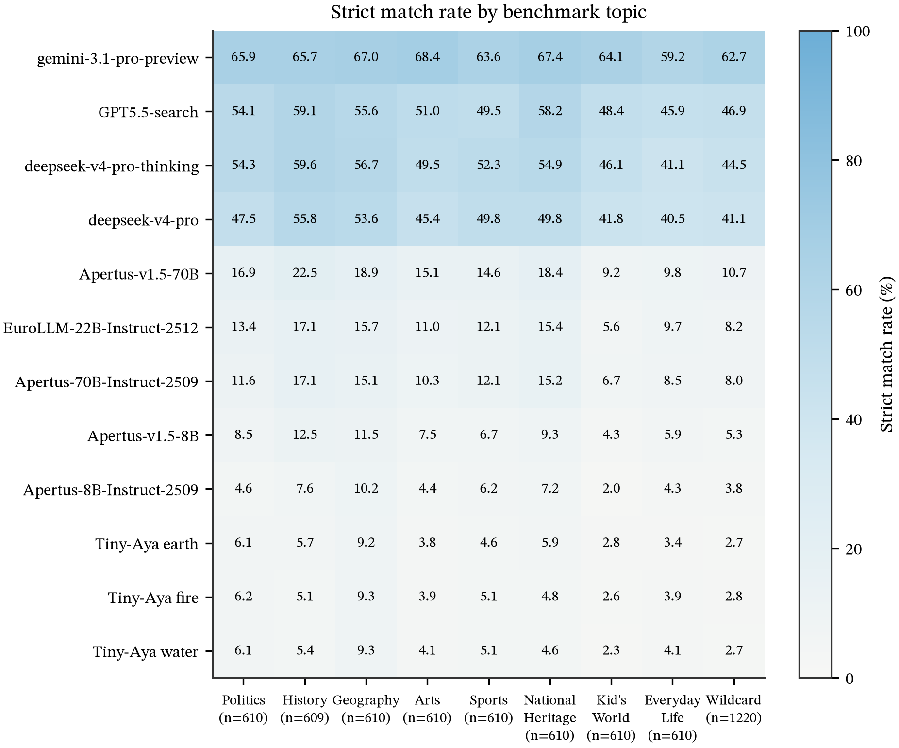

_Figure M3. Strict match rate by topic; cells give exact rates and x-axis labels give the number of evaluated riddles._

Regional rankings are similarly consistent (median Spearman rho = 0.92), with
the three Tiny-Aya variants the only substantial departures (rho = 0.51--0.60;
all other models are at least 0.83). A model-averaged regional ranking is thus a
more economical main-text summary than the near-parallel rows.
North America has the highest aggregate match rate (42.1%), followed by the
Caribbean (35.9%; only 99 evaluated riddles) and South America (32.4%).
Sub-Saharan Africa is lowest (8.3%). These gaps combine language, community,
topic, answer conventions, and conservative string matching; they are audit
signals rather than causal estimates of model capability.

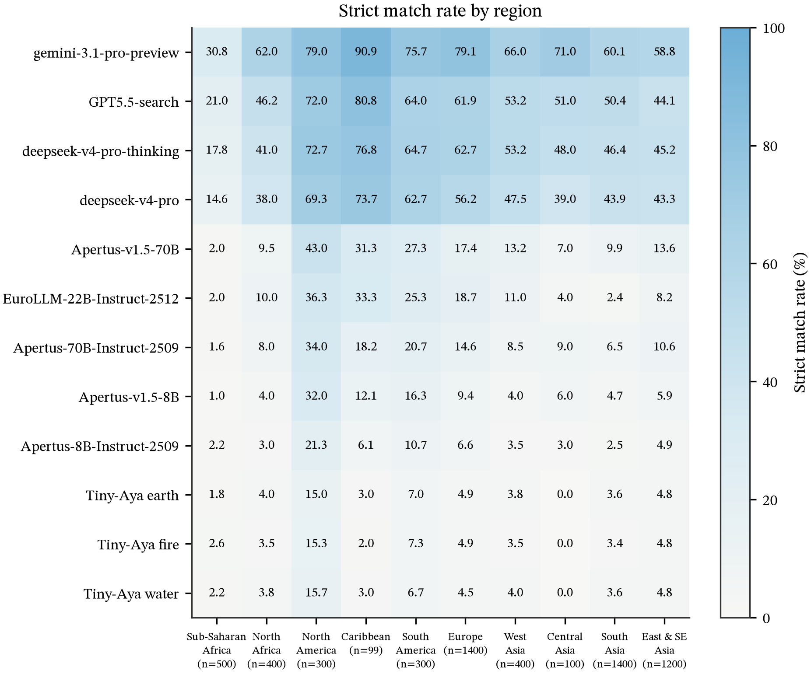

_Figure M4. Strict match rate by region; cells give exact rates and x-axis labels give the number of evaluated riddles._

Language-group labels report the number of communities averaged, highlighting
the limited support for several groups (for example, English has two communities
and Arabic varieties six).

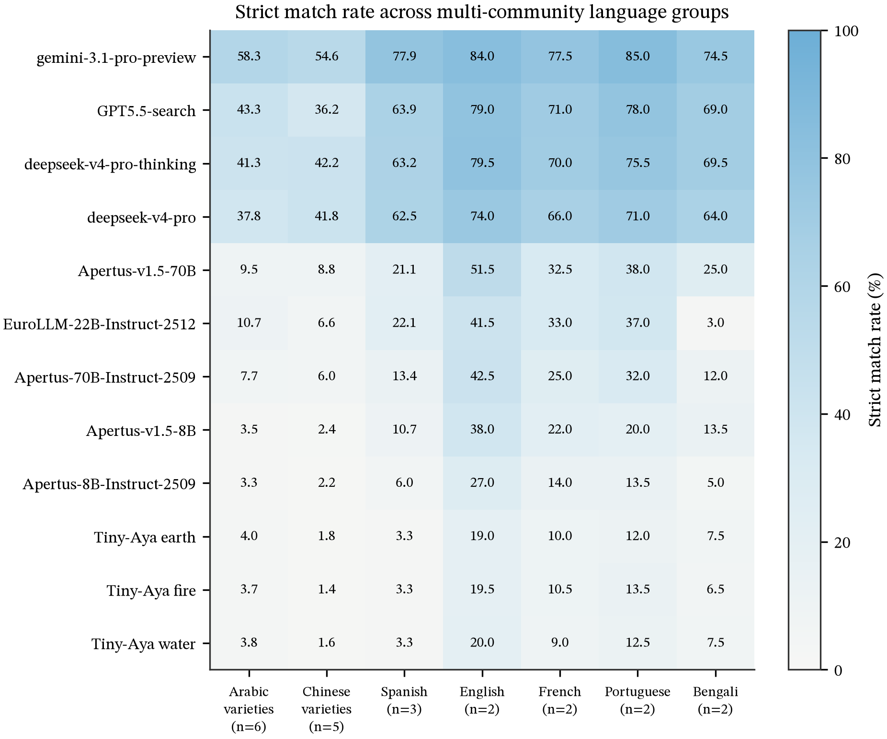

_Figure M5. Strict match rate across multi-community language groups; cells give exact rates and x-axis labels give the number of communities averaged._

### Thinking mode

On the 6,099 riddles paired across the two DeepSeek configurations, thinking
improves strict match rate in every topic. The overall gain is 3.7 percentage
points; Politics has the largest gain (+6.7 pp) and Everyday Life the smallest
(+0.7 pp).

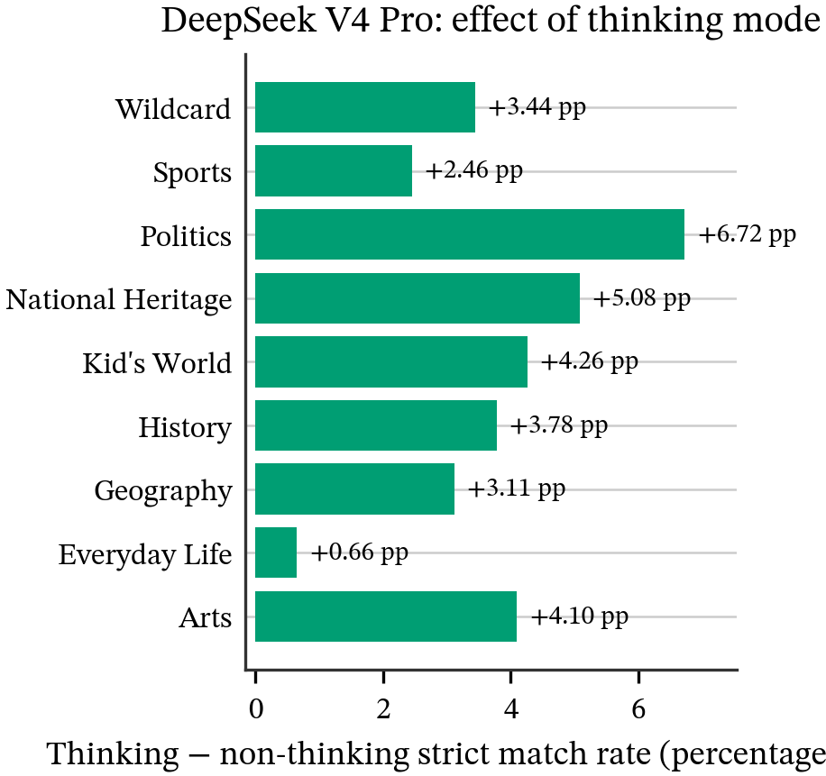

_Figure M6. Paired difference in strict match rate (thinking minus non-thinking); labels give percentage-point changes._

The archive contains a complete GPT5.5 Search run but no matched no-search run,
so it cannot estimate the effect of search. The deterministic matcher normalizes
Unicode, case, whitespace, punctuation, and simple reference alternatives; it
does not translate, transliterate, stem, or infer synonyms. Consequently,
language and regional patterns require LLM-judge or human validation before
they support paper-level causal claims.
