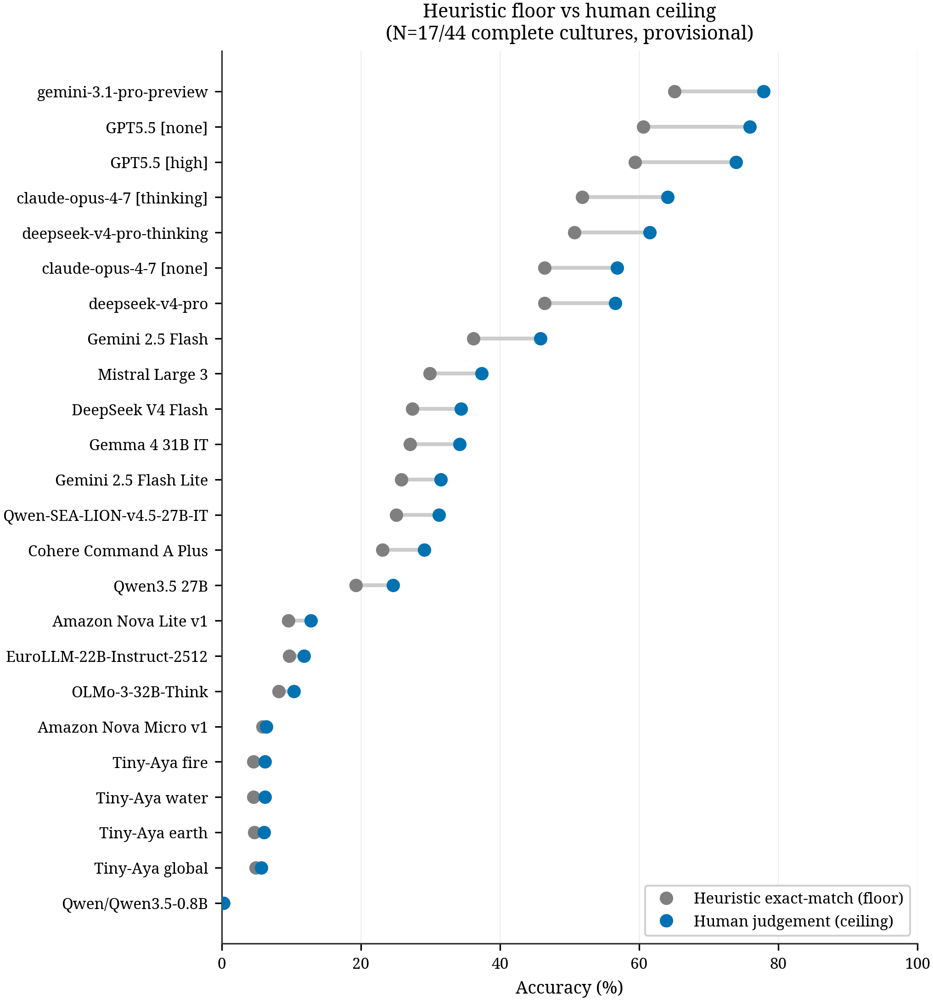
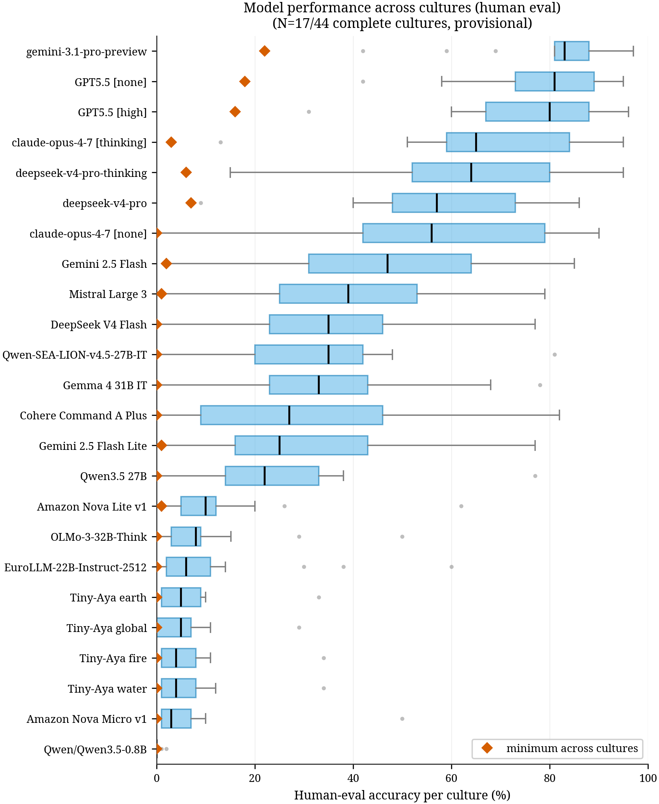
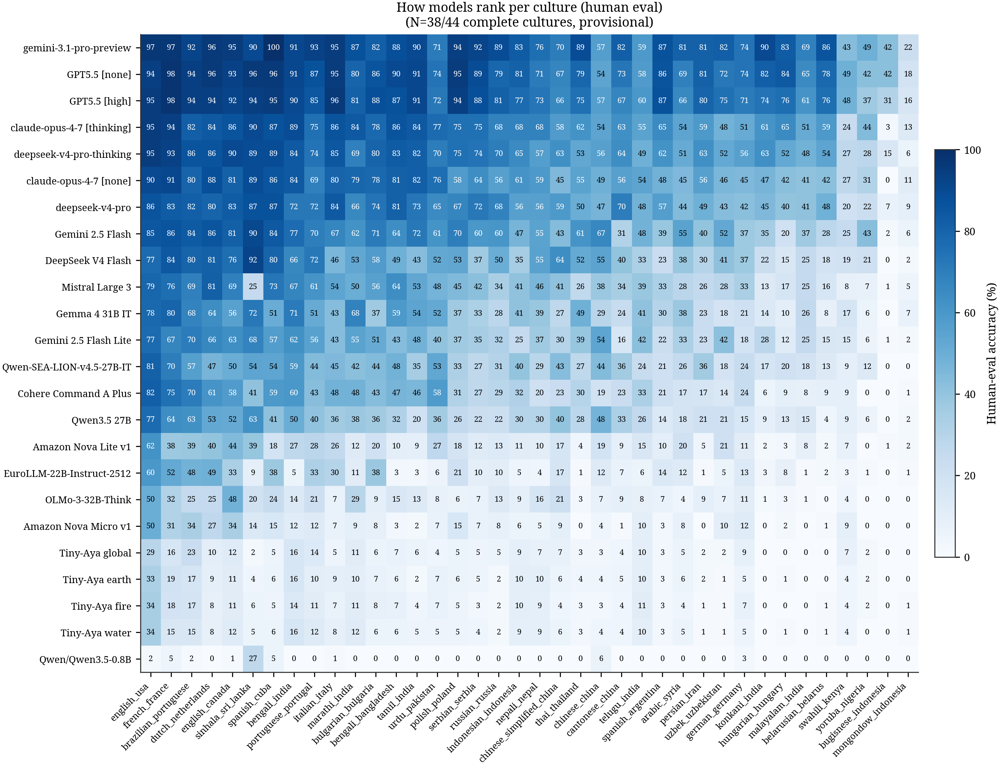
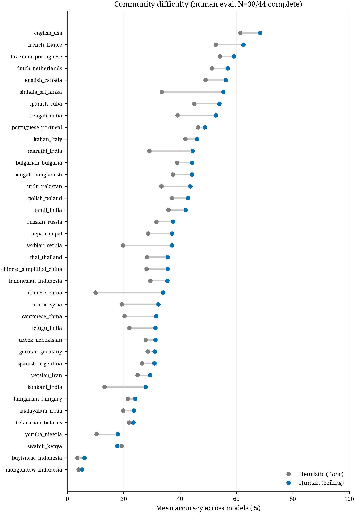
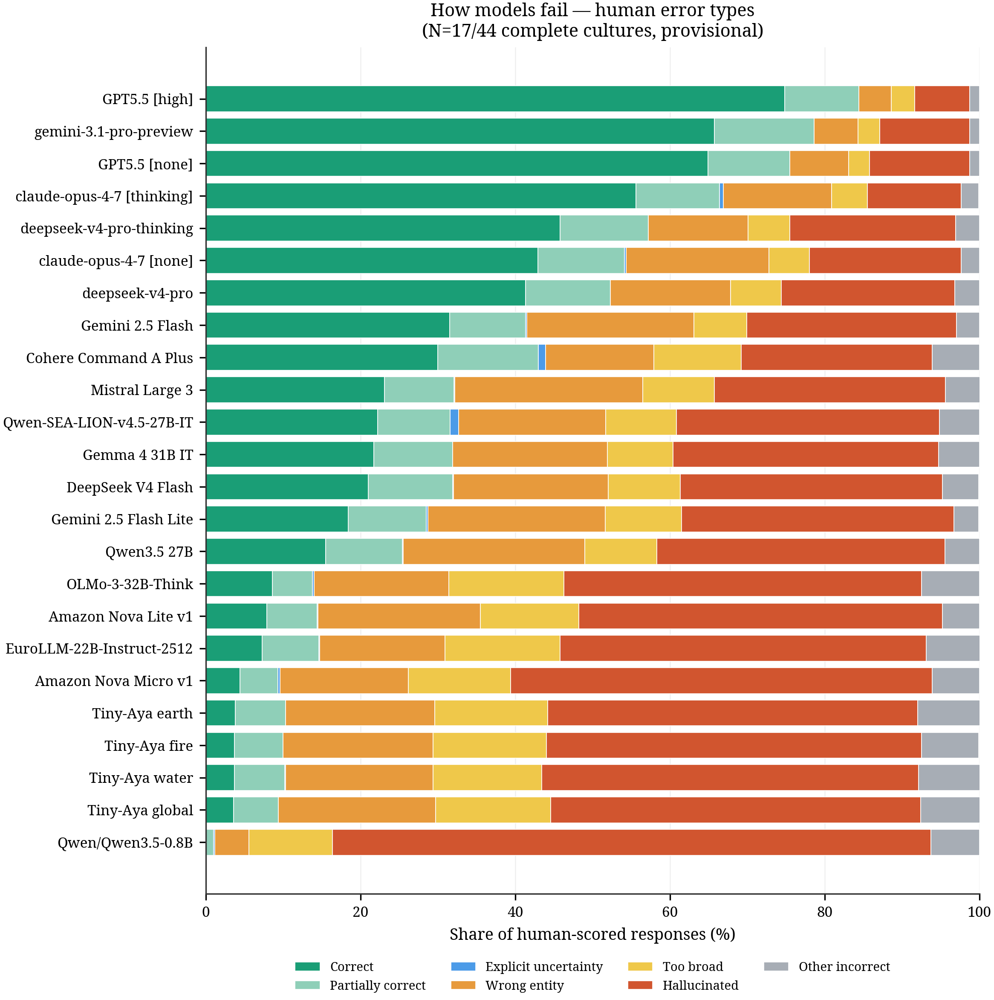
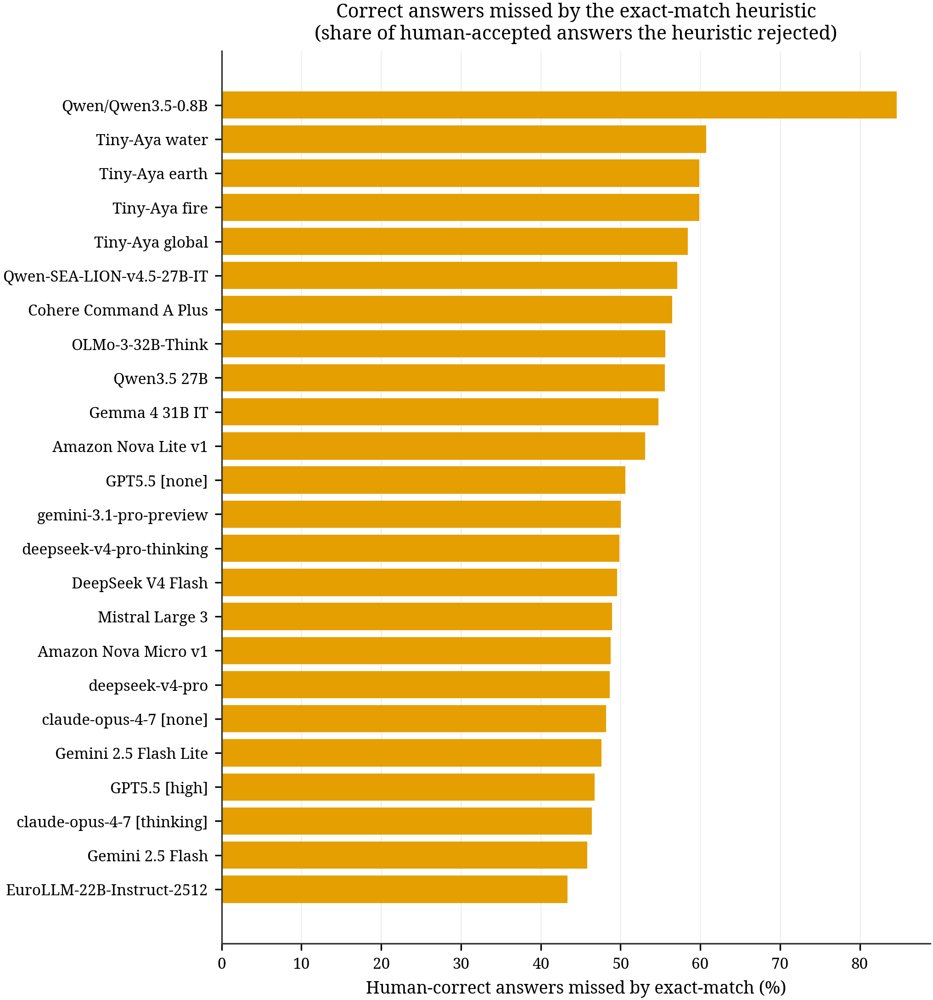
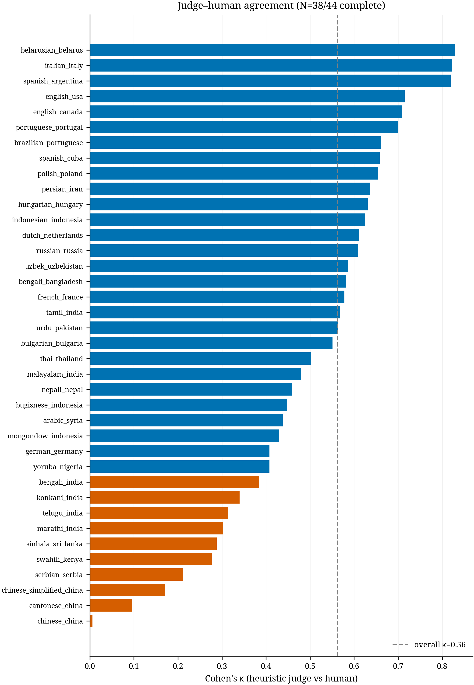

# Human-evaluation figures — how to read them

Provisional results from the **human evaluation** of the Multicultural Riddles
Benchmark, computed on the **17 of 44 cultures** with complete human coverage
(numbers will shift as coverage grows). Every value traces to Henry's
`model_riddle_results_flat.csv`; pending answers are dropped, never guessed.

Two scores appear throughout:

- **Heuristic (floor)** — the automatic judge: reference-based string matching
  (exact match after normalization). A conservative _lower bound_.
- **Human (ceiling)** — a native speaker's judgement on a 0–3 scale
  (0 hallucination, 1 admits not knowing, 2 partially correct, 3 correct).
  "Correct" here means the top score of 3 (strict).

Rerun everything after a newer flat file is dropped in:
`python analysis/model_results_v0/human_eval_figures.py`

---

## Insights for the paper (provisional, 17/44 cultures)

Written to be lifted directly. All numbers are from the current human-eval
snapshot on the 17 fully-evaluated cultures and will firm up as coverage grows.

1. **Human-curated riddles remain hard for frontier models.** Under human
   evaluation the strongest model reaches only 77.9% accuracy (Gemini 3.1 Pro),
   followed by GPT-5.5 (75.9%) and GPT-5.5 high-effort (73.9%); most models score
   far lower, and the mean across all evaluated models is 33.4%.

2. **Automatic exact-match scoring understates ability, most of all for the best
   models.** Human judgement lifts every model above its heuristic score — Gemini
   from 65.1% to 77.9%, GPT-5.5 high-effort from 59.4% to 73.9% — because
   string-matching rejects correct answers phrased differently. Overall, the
   heuristic misses **45.9%** of the answers humans accept as correct (3,188 of
   6,948), so a purely automatic score would badly understate the models.

3. **The automatic judge only moderately agrees with humans, and breaks down on
   non-Latin scripts.** Cohen's κ between heuristic judge and human is 0.60
   overall ("substantial"), but falls below 0.4 for cultures such as Cantonese
   (0.10), Serbian, Marathi and Telugu — motivating human evaluation over
   heuristic scoring alone.

4. **When models fail, they fabricate rather than abstain.** Hallucination is the
   dominant error mode and scales inversely with capability — from 7.1% of
   responses for the strongest model to 77.3% for the smallest — while models
   almost never admit uncertainty (mean 0.18%). The typical failure is a
   confident wrong answer, not an "I don't know."

5. **Difficulty varies enormously across cultures, and even top models are
   uneven.** Mean accuracy ranges from 68.4% (English–US) to 5.2% (Mongondow,
   Indonesia), with regional Indonesian languages near-zero for almost every
   model. Robustness matters: Gemini averages ~85% on a typical culture but drops
   to 22% on its weakest, so a single leaderboard number hides large per-culture
   gaps.

6. **Scope.** Human evaluation covers 24 models on v0 (17 of 44 cultures complete
   so far); the full-corpus automatic leaderboard covers 12 models across v0–v2.
   All human-eval numbers are provisional until coverage completes.

---

## Models and language coverage

**Corpus by round.** Each round adds cultures. The automatic judge covers every
round; human evaluation so far covers v0.

| Round | Communities | Languages | Riddles |
|---|---:|---:|---:|
| v0 | 44 | 38 | 4,400 |
| v1 | +4 | +4 | +400 |
| v2 | +13 | +12 | +1,300 |
| **Total** | **61** | **51** | **6,100** |

v1 adds Tunisian Arabic, Assamese, Kannada, Ukrainian. v2 adds Levantine Arabic,
Catalan, French, Afaan Oromo, Gujarati, Japanese, Luxembourgish, Sindhi,
Turkish, Vietnamese, Chinese, Malay. (Full v0 language list in paper Appendix A.)

**Why the model count differs between figures** — three different sets appear
across the paper, which is the common point of confusion:

- **24 models** have human evaluation — all on **v0** (these figures).
- **12 models** have complete **v0–v2 automatic** coverage — the full-corpus
  leaderboard (paper Table 5).
- Only **7** are in both.
- **5 are automatic-only, no human eval yet** — the four Apertus models and
  GPT5.5-search. These were added later (Apertus by Hannah), so human validation
  for them on v0 has not been done.
- The other **17 human-eval models** ran only v0 automatic, so they are not in
  the full-corpus leaderboard.

Human evaluation is v0-only; the automatic judge covers every round.

| Model | Human eval (v0) | Full v0–v2 (automatic) |
|---|:---:|:---:|
| Apertus-70B-Instruct-2509 | — | yes |
| Apertus-8B-Instruct-2509 | — | yes |
| Apertus-v1.5-70B | — | yes |
| Apertus-v1.5-8B | — | yes |
| deepseek-v4-pro | yes | yes |
| deepseek-v4-pro-thinking | yes | yes |
| EuroLLM-22B-Instruct-2512 | yes | yes |
| gemini-3.1-pro-preview | yes | yes |
| GPT5.5-search | — | yes |
| Tiny-Aya earth | yes | yes |
| Tiny-Aya fire | yes | yes |
| Tiny-Aya water | yes | yes |
| Amazon Nova Lite v1 | yes | — |
| Amazon Nova Micro v1 | yes | — |
| claude-opus-4-7 [none] | yes | — |
| claude-opus-4-7 [thinking] | yes | — |
| Cohere Command A Plus | yes | — |
| DeepSeek V4 Flash | yes | — |
| Gemini 2.5 Flash | yes | — |
| Gemini 2.5 Flash Lite | yes | — |
| Gemma 4 31B IT | yes | — |
| GPT5.5 [high] | yes | — |
| GPT5.5 [none] | yes | — |
| Mistral Large 3 | yes | — |
| OLMo-3-32B-Think | yes | — |
| Qwen-SEA-LION-v4.5-27B-IT | yes | — |
| Qwen/Qwen3.5-0.8B | yes | — |
| Qwen3.5 27B | yes | — |
| Tiny-Aya global | yes | — |

---

## Heuristic floor vs human ceiling



Per model, the grey dot is the automatic exact-match score and the blue dot is
the human score; the line between them is the lift from human judging. **How to
read:** the gap is what string-matching misses — real correct answers a
person recognizes but the exact-match check rejects. The gap is largest for the
strongest models, so automatic scoring understates the best models the most.

---

## Model performance across cultures (box plot)



Each model was scored on 17 cultures, giving 17 accuracy numbers; the box shows
how they are spread. **How to read:** the box is the middle half of cultures,
the line inside is the median culture, whiskers are the typical range, grey dots
are outlier cultures, and the **red diamond is the model's lowest culture**. A
high box that is also tight = strong _and_ consistent; a low diamond or a wide
box = uneven across cultures.

---

## How models rank per culture (heatmap)



The same data as the box plot, but naming every culture. Rows are models (best
on top), columns are cultures (easiest on the left, hardest on the right), each
cell is that model's accuracy there. **How to read:** scan a row to see where a
model wins and collapses; scan a column to see which cultures are hard for
everyone. English/Italian are easy for all; the Indonesian regional languages
(Buginese, Mongondow) are near-zero for almost every model.

---

## Which cultures are hardest (community difficulty)



Mean accuracy across all models per culture, floor vs ceiling. **How to read:**
lower = harder for models in general. This is the column-averages of the
heatmap, sorted, so it isolates _culture_ difficulty from model strength.

---

## How models fail (human error types)



For each model, the breakdown of what its answers actually were when a person
judged them. **How to read:** green = correct, and the coloured segments are the
failure modes — **hallucinated** (made-up answer, red), **wrong entity** (right
category, wrong specific answer), **too broad** (generic answer), plus partially
correct and explicit uncertainty. The key pattern: hallucination dominates and
grows as models get weaker (≈7% for the best, ≈77% for the smallest), while
models almost never admit uncertainty (blue is barely visible) — they produce a
confident wrong answer instead.

---

## Correct answers missed by the exact-match heuristic



Take only the answers a **human marked correct**, then ask what share the
automatic exact-match judge scored as _wrong_. **How to read:** higher = the
automatic judge throws away more genuinely-correct answers (synonyms,
translations, reworded answers). This is the concrete cost of automatic-only
scoring, per model.

---

## Does the auto-judge agree with humans? (Cohen's κ)



Cohen's κ measures how well the **automatic judge** agrees with the **human**,
per culture — corrected for chance agreement. **How to read:** 0 = no better
than random, 1 = perfect. Rough scale: <0.2 poor, 0.2–0.4 fair, 0.4–0.6
moderate, 0.6–0.8 substantial, >0.8 near-perfect. **Red bars (κ < 0.4)** are
cultures where string-matching is unreliable — mostly non-Latin scripts. The
dashed line is the overall κ (≈0.60).

**Formula.** Two raters (here: auto-judge and human) label the same items:

```
        p_o − p_e
κ  =  ─────────────
         1 − p_e
```

- `p_o` = observed agreement = share of items both rate the same way.
- `p_e` = agreement expected by chance = for correct/incorrect,
  `P(judge=correct)·P(human=correct) + P(judge=wrong)·P(human=wrong)`.

Worked example (our numbers, 31,965 doubly-labelled answers): both correct
3,760; judge-only 540; human-only 3,188; both wrong 24,477.
`p_o = (3,760+24,477)/31,965 = 0.883`;
`p_e = 0.134·0.217 + 0.866·0.783 = 0.707`;
`κ = (0.883−0.707)/(1−0.707) = 0.60`.

Note raw agreement is 88% but κ is only 0.60, because both raters usually say
"wrong," so much of that 88% is chance — which is exactly why we report κ.
